# Sub-pages

[\[Model\] Matrix-Game 4.0](https://chatgpt.com/space/page_e21c5b8e20d481919920e3d789fc5a92)&#x20;

[模型子页面](https://chatgpt.com/space/page_22f4dd66851c8191a98a4e46908ae20c)

# 引言

World Model（世界模型）想解决一个朴素的问题：**根据已经看到的世界，预测它接下来会怎样变化；如果我采取一个行动，变化又会有什么不同。** 对关注 video generation（视频生成）的人来说，这意味着从生成一段影片，走向生成一个可以转动镜头、操控角色、改变事件并持续发展的世界。

本文从零基础出发，先建立直觉，再解释常见技术，最后重点介绍 video generation 与交互世界方向的代表工作。前沿内容截至 **2026 年 10 月 15 日**，覆盖经典研究以及 2026 年的重要进展；文中的代表作各有所长，不构成统一排行榜。

**阅读路线**：第一次建议按第 1 至 4 节顺序阅读，先看插图建立直觉，再结合框图理解模型结构与运行；第 5 节介绍 video generation 前沿，第 7 节提供阅读演示与论文的检查清单。

**插图说明**：除另有来源标注外，本文的概念插图均由 AI 生成，用于辅助理解，不代表任何 world model 的实际测试结果。后续图注不再逐一重复说明。

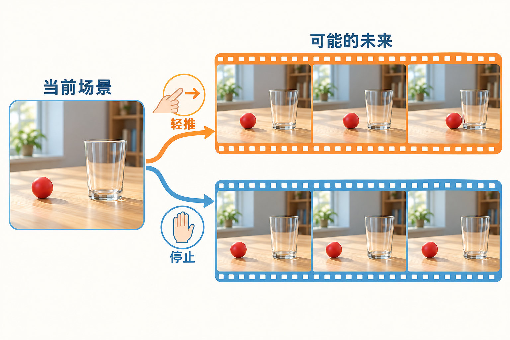

*同一场景，不同行动，可能产生不同未来。图中的“停止”表示让球保持不动这一控制条件。*

# 1 从红球和杯子理解 world model

想象你看见一颗红球正在桌上向玻璃杯滚动。即使只看了几秒，你也会预想它可能撞到杯子；如果有人把球拦住，你又会改变预测。你不仅认出了“球”和“杯子”，还在利用关于运动、接触、遮挡和 object permanence（物体持续存在）的经验。

可以把 world model 理解为 AI 学习到的一套**关于环境如何变化的内部预测机制**。这里的“世界”可以很小，例如一个桌面、一段道路或一个游戏关卡；不必一开始就模拟整个现实世界。

## 三个问题对应三类能力

| 我们问模型什么 | 模型需要做什么 | 红球例子 |
| - | - | - |
| 现在看到了什么 | 通过 perception 与 representation 保留当前信息 | 找到球、杯子和桌面 |
| 接下来可能发生什么 | 根据历史预测未来 | 推测球的方向、速度和碰撞 |
| 如果采取不同操作会怎样 | 根据 action（动作）或控制条件预测不同未来 | 轻推、拦截、移动杯子分别产生什么变化 |

这三个问题是观察模型能力的角度。不同研究对“world model”的用法并不完全一致：reinforcement learning（强化学习）通常强调 action、reward（奖励）和决策；视频领域则经常强调视觉预测、生成、交互和 spatiotemporal consistency。2018 年的 [World Models](https://worldmodels.github.io/) 和 Google 的 [Genie 3](https://deepmind.google/blog/genie-3-a-new-frontier-for-world-models/) 就体现了不同侧重点。

## 只需要记住这一条关系

**可能的未来 = 过去的 observation（观察） ＋ 可选的 action 或控制条件**

“可能”很关键。仅凭几帧视频，模型通常不知道球有多重、桌面有多滑、画面外是否有人，所以同一段历史可能对应多种未来。好的模型应当在信息不足时保留合理的不确定性。

另一个容易忽略的区别是：**转动相机改变的是 observation 的视角，推球改变的是 scene state。** 两者都可以作为模型输入，却不是同一种控制能力。只有 camera control 的模型，未必能准确模拟物体之间的作用。

# 2 world model 到底是什么样的模型

## 先把功能 方法和 network architecture 分开

**world model 不是一种固定的 network architecture。** 它首先描述一种功能：根据已有 observation 和可能采取的 action，预测环境接下来如何变化。实现这个功能的 neural network，可以是 RNN、Transformer，也可以是 diffusion model（扩散模型）中的 denoising network。

学术界和业界对 world model 的表述各有侧重。结合各自的研究语境，可以更清楚地理解这项预测功能。

**学术界：DreamerV3 论文对 world model 的描述**

> The world model learns compact representations of sensory inputs through autoencoding and enables planning by predicting future representations and rewards for potential actions.

—— Hafner 等，[Mastering diverse control tasks through world models](https://www.nature.com/articles/s41586-025-08744-2)，Nature，2025，World model learning 小节。

这里描述的是 DreamerV3 的具体实现：先把传感器输入压缩成 representation，再预测采取不同 action 后，未来的 representation 和 reward 会怎样变化。这些预测可以支持 agent 学习怎样行动。它强调的是**预测行动后果以支持决策**；预测对象可以是内部的 representation，无须每次都生成一段给人观看的视频。

**业界：Google DeepMind 对 world model 的描述（原文节选）**

> world models, which are AI systems that can use their understanding of the world to simulate aspects of it

—— Google DeepMind，[Genie 3: A new frontier for world models](https://deepmind.google/blog/genie-3-a-new-frontier-for-world-models/)，2025 年 8 月 5 日。

这段描述把 world model 看成能够模拟世界某些方面的 AI 系统。原文随后强调，agent 可以借此预测环境如何演变，以及自己的 action 会怎样影响环境。结合 Genie 3，直观的形式就是：你输入移动或转向操作，系统继续生成随后看见的画面。它强调的是**可随交互持续展开的模拟环境**。

这两个表述都把重点放在**环境的演变与行动的后果**上。本文据此采用功能性的理解：先明确模型要预测什么，再讨论它用哪种 architecture 实现。不同研究还会针对 video generation、control 或 planning，选择不同的预测对象和输出形式。

“video diffusion model”和“world model”因而可以指向同一个系统的不同侧面：前者说明它怎样生成数据，后者说明它承担什么预测任务。DIAMOND 就是直接的实例：作者训练一个 conditional diffusion model，根据过去的游戏画面和 action 生成下一帧，并把它用作环境模型。[DIAMOND 项目说明](https://diamond-wm.github.io/)

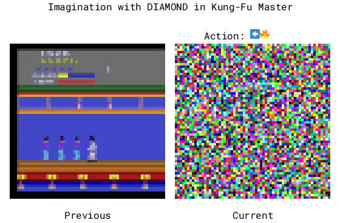

*DIAMOND 作者提供的 Kung Fu Master 方法动画。图源：[Alonso 等 DIAMOND 项目页](https://diamond-wm.github.io/)，[原始动画](https://diamond-wm.github.io/static/gifs/kungfu.gif)，许可为 [CC BY-SA 4.0](https://creativecommons.org/licenses/by-sa/4.0/)。*

读这张动画时，先看三个位置：左侧 **Previous** 是近期的游戏画面；上方 **Action** 是本轮输入的操作；右侧 **Current** 是模型在这些条件下生成的当前画面。箭头表示方向，火焰符号表示游戏操作。

例如，已有画面显示角色与对手的位置，本轮又给出了向左移动或攻击等操作，diffusion model 据此生成后续画面。动画右侧从彩色噪声逐渐形成游戏图像，展示的是同一个目标画面的 sampling 过程。下一轮再接收 action，刚生成的画面又成为历史的一部分。[作者对方法的说明](https://diamond-wm.github.io/)

所以，在这张图里，**diffusion model 既负责生成画面，也承担预测环境如何响应 action 的职责**。玩家或 policy 给出操作，模型产生操作后的可见结果；不断重复，就形成可交互的视觉环境。这里可以直接把条件生成流程理解为预测环境响应的模型。

| 描述的维度 | 对应术语或方法 | 在同一个系统里具体指什么 |
| --- | --- | --- |
| Task 与功能 | world model | 根据已有信息预测环境变化或 action 的后果 |
| Generative modeling | diffusion model 或 flow matching model | 学习怎样从 noise 生成符合条件的未来内容 |
| Network architecture | Transformer 或 U-Net | 执行预测计算的 neural network backbone |
| Representation | VAE latent 或 pixels | 生成过程中处理的数据形式 VAE 负责 pixels 与 latent 之间的转换 |
| Generation order | autoregressive generation | 先生成一个 frame 或 video chunk 再根据已有内容继续生成 |

这里的五行不是五种互斥的模型，而是从五个角度描述同一套系统。例如，假设某个系统“用 Transformer 处理 VAE latent，以 flow matching 训练，再按 video chunk 进行 autoregressive generation，完成 world prediction”。可以把这句话逐项拆开：

1. **它做什么**：称为 world model，说明它承担预测环境变化或 action 后果的任务。

2. **用什么网络计算**：使用 Transformer，说明主要计算由 attention layer、feed-forward network（FFN）等构成。

3. **主要处理什么 representation**：在 VAE latent 中生成，说明生成过程主要操作压缩后的 tensor，再把结果 decode 成画面。

4. **训练时怎样学习生成**：使用 flow matching，说明网络通过相应的 vector field learning objective，学会在 noise 与数据分布之间进行生成。

5. **运行时怎样延长视频**：按 video chunk 进行 autoregressive generation，说明先生成一块，再把已有内容作为条件继续生成后面的块。

把这些描述合起来，才得到一套具体系统：收到历史画面与“向前走”的 action 后，Transformer 在 latent 上计算预测，sampler 形成下一 video chunk，VAE decoder 把它还原为画面；系统再用已有内容继续生成。**world model 说明它承担什么任务，其他术语说明它怎样实现这个任务。** 这些描述维度不是网络内部依次排列的五个模块。DiT 是采用 Transformer backbone 实现 diffusion modeling 的代表性例子。[DiT 原始论文](https://arxiv.org/abs/2212.09748)

## observation 和完整 environment state 有什么区别

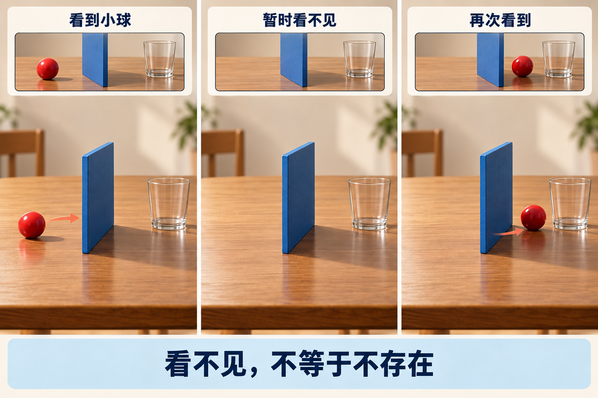

*小球被遮挡后，当前画面不再包含它。要预测它何时重新出现，需要结合先前的运动信息；单张当前画面通常不够。*

在专业表述中，可以区分 **environment state** 和 **observation**。environment state 包含决定后续变化的相关信息，例如位置、速度、接触关系，甚至当前看不见的物体；observation 只是相机或其他传感器获得的部分信息。两段视频可能在某一 frame 看起来相同，却因为画面外情况或运动速度不同，拥有不同未来。

模型通常无法直接读到完整 environment state，所以会利用 observation history 构造 internal representation，保留对预测有用的信息。这种 representation 可能是 video features、历史 frame cache、RNN 的 hidden state 或 explicit 3D structure。**它不一定长得像一间三维房间，也不一定是一张写着物体坐标的表。** 在许多 video model 中，你实际能看到的只是 tensor 和 cache；是否编码了稳定的物体与空间关系，需要通过实验判断。

这里容易混淆，是因为 latent 并不是一个只对应某种模块的专用名称。它泛指模型内部没有直接以原始 observation 形式呈现的变量或 representation。理解它时，应先问：**这组数据用来压缩 observation，还是用来汇总预测所需的历史？** 这两种作用可以由不同变量承担，也可能在同一个系统中相互结合。

### 用来压缩 observation 的 representation

以 single-frame VAE 为例，encoder 将当前画面 `obs_t` 转成更紧凑的 visual code，可写成 `z_t = encoder(obs_t)`；decoder 再根据 `z_t` 重建画面。这里的 **compression** 是 learned representation compression：encoder 通过学习将大量 pixel values 映射到较少的 latent values，通常减少空间位置的数量；video VAE 还可能压缩时间维度。Training 会兼顾 reconstruction quality 与 latent distribution 的约束，因此这种表示通常有信息损失。[Latent Diffusion 论文](https://arxiv.org/abs/2112.10752)

**Compression 说明表示有多紧凑，latent space 说明模型在哪种表示中工作。** 经过 VAE encoder 压缩得到的 `z_t` 正是 VAE latent；这两个说法描述同一条路线的不同侧面。DIAMOND 采用的 pixel-space diffusion 则直接在 RGB tensor 上 sampling，后文会专门对比。

假设两段视频里，小球在当前这一帧都处于同一个位置：一段此前向左移动，另一段此前向右移动。只看当前帧，两者可能几乎一样；但要预测下一刻，先前的移动方向很重要。**能把当前画面重建出来，不等于已经保存了区分这两段历史所需的信息。**

### 用来汇总历史的 predictive representation

预测模型还需要利用先前的 observation 和 action。例如，RNN 可以在处理序列时持续更新一个 hidden state `h_t`，把过去发生的变化汇总成当前可用的 features。它可能帮助区分小球的运动方向、遮挡前的轨迹或先前操作的影响，但这些信息通常以 distributed representation 存在，不一定对应可读的“速度”或“位置”字段。

在经典的 World Models 2018 中，VAE encoder 产生 visual encoding `z_t`，MDN-RNN 维护 recurrent state `h_t`，再结合 current action `action_t` 预测下一 visual encoding 的分布：

```math
p\!\left(z_{t+1}\mid z_t,h_t,a_t\right)
```

这里，`z_t` 提供当前视觉信息，`h_t` 提供历史信息，`action_t` 提供本轮控制。公式中的竖线表示“在这些信息给定的情况下”。[World Models 的 Agent Model 与训练过程](https://worldmodels.github.io/)

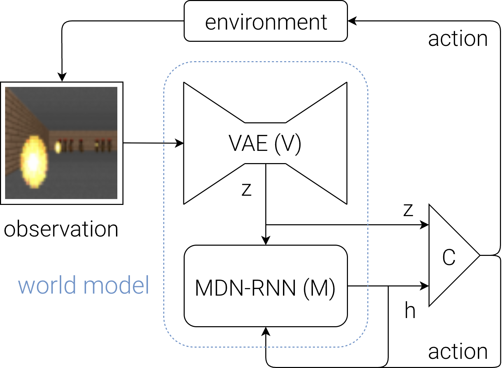

*World Models 官方 Agent Model 原图，作者 David Ha 与 Jürgen Schmidhuber，2018。图中 VAE（V）是整套视觉表示模型的名称；沿 observation → z 的箭头使用的是它的 encoder。MDN-RNN（M）提供 recurrent prediction，C 表示 controller。VAE decoder 主要用于 reconstruction 与 imagined frames 的可视化，没有在这张控制回路图中单独展开。图片取自 [World Models 交互论文](https://worldmodels.github.io/)，由原始 SVG 渲染。*

沿箭头读一遍：environment 返回 observation，VAE encoder 得到当前 `z_t`；controller 读取 `z_t` 与 recurrent state `h_t`，输出 action；action 影响 environment，也与 `z_t` 一起用于更新 RNN。**当前 visual encoding 与历史 recurrent state 是两条互补的信息来源。** 原文的训练分工是先学习 VAE，再用 observation 与 action 序列训练 MDN-RNN，最后搜索 controller 的参数；VAE decoder 还可把 sampled latent 还原成可看的 imagined frames。[原文 Agent Model 与 Training Procedure](https://worldmodels.github.io/)

作者把 world model 模拟出的环境称为 **dream environment**。在 VizDoom: Take Cover 实验中，MDN-RNN 根据 action 预测后续 latent 与 episode 是否结束，controller 在这个 learned environment 中训练，再回到原始游戏环境测试。“梦境”在这里指 model-generated rollout；训练可以直接在 latent space 进行，VAE decoder 用于把轨迹可视化给人观看。[World Models 的 VizDoom 实验与训练过程](https://worldmodels.github.io/)

| 要比较的 representation | 主要描述什么 | 在小球例子中的作用 |
| --- | --- | --- |
| 当前画面的 visual encoding `z_t` | 当前 observation 中的视觉内容 | 保留小球和场景此刻的外观线索 |
| recurrent state `h_t` | 随序列更新的历史 features | 利用过去画面和 action 区分不同运动历史 |
| predictor 使用的组合 `z_t, h_t, action_t` | 当前 observation 历史与本轮操作 | 共同决定 next observation 的预测分布 |

### video model 中不一定存在独立的历史向量

video VAE 可以一次编码多个 frame，因此其 latent 也可能包含时间与运动线索；不能简单说“VAE latent 只表示静态外观”。但它能否保留某项长期预测所需的信息，仍取决于输入范围、compression 和 training objective。

现代 video world model 也可以把历史 video latent 作为 Transformer 的 context，再配合 history retrieval 或 cache，而没有单独命名为 `h_t` 的 RNN state。这里的 memory 可以是一组可被重新读取的历史 video representations；当前预测通过 attention 利用它们。[WorldPlay 的 history context 设计](https://arxiv.org/html/2512.14614v2#S3.S3)

### 用 WorldPlay 的回头看理解 context memory

假设你在一个房间里控制相机：起初看见红色沙发和旁边的落地灯，随后向前走、转向门口。过了一会儿，最近几段视频只包含门口。当你转身再看沙发时，只参考最近画面，已经找不到沙发外观与布局的直接线索；更早的画面却保留了这些信息。

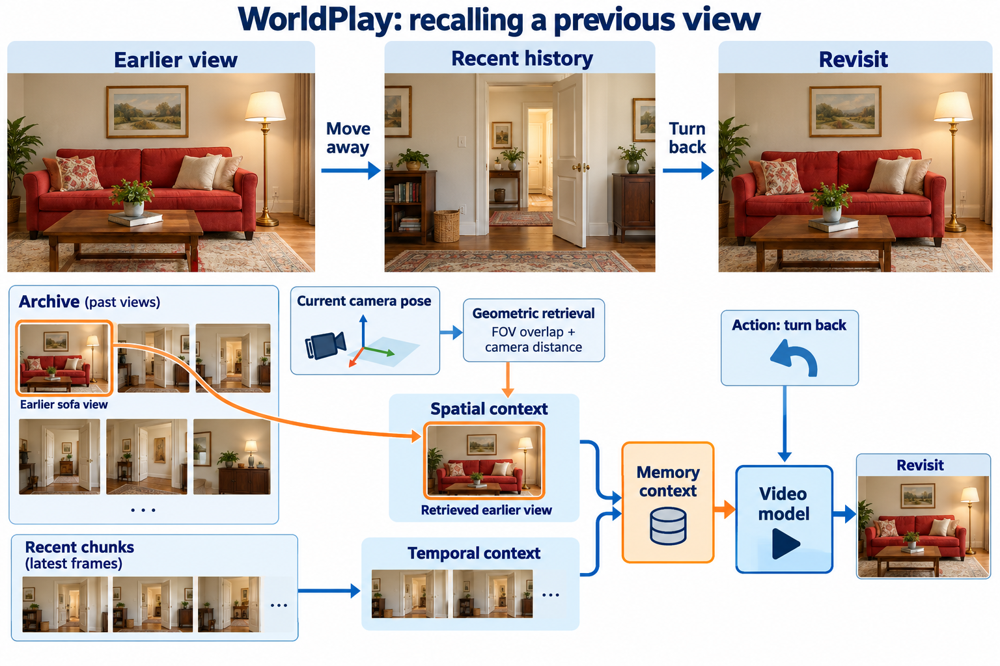

*上排展示离开沙发视角、朝向门口、再转回来的过程。下排显示两种 memory 来源：recent chunks 提供 temporal context，较早的沙发画面经 geometric retrieval 成为 spatial context，再共同参与下一次 video prediction。*

WorldPlay 会为每个新 video chunk 重新组织 memory context：一部分来自最近的 chunks，另一部分来自时间上较远、但与待生成视角在几何上相关的历史 frames。这里的“相关”有具体的选择依据：利用 camera pose，比较 field-of-view（FOV）overlap 与相机位置关系，再在有限 context budget 下选择历史片段。[WorldPlay 第 3.3 节](https://arxiv.org/html/2512.14614v2#S3.S3)

| 在这个例子中读取什么 | 提供什么线索 | 怎样参与下一次预测 |
| --- | --- | --- |
| Recent chunks | 刚才朝门口移动和转身的连续变化 | 帮助后续运动接上当前片段 |
| Retrieved historical frames | 更早看到的沙发 立灯和布局 | 为重访该区域提供 visual references |
| Current action 与 camera pose | 现在继续向哪边移动或转向 | 约束本轮要预测的视角与后续画面 |

这些内容一起成为生成下一 video chunk 的 conditioning，帮助重访时保留场景一致性。这里既不要求一个独立的 RNN 向量记住整间房，也不是把旧图简单贴回输出。**历史信息能参与预测，是因为它被保存、检索并实际送进了网络。** 官方 inference pipeline 也明确描述了“逐 chunk 预测，并从过去 chunks 重组 context memory”的工作流。[WorldPlay 官方实现](https://github.com/Tencent-Hunyuan/HY-WorldPlay#-introduction)

## 用一个 conditional probability 把任务写清楚

对于本文关注的 action-conditioned video prediction，可以写成：

```math
\begin{aligned}
&p_\theta\bigl(\text{future video}\mid\\
&\quad\text{observation history},\\
&\quad\text{action sequence},\\
&\quad\text{other conditions}\bigr)
\end{aligned}
```

更紧凑的数学写法是：

```math
p_\theta\!\left(O^{+}\mid H_t,A^{+},c\right)
```

O⁺ 表示要预测的 future observations，A⁺ 表示相应的 action sequence，Hₜ 汇总已有的 observations 与相关 past actions，c 表示额外 conditioning，例如 text 或首帧。θ 是训练得到的模型参数；prediction horizon 决定要向前预测多长。行内变量使用 `obs_t`、`action_t`、`horizon` 等 ASCII 命名，单独展开的公式使用数学记号。

这不是要求模型只猜一个必然结果，而是学习**这些条件下哪些未来可能发生，以及它们的相对可能性**。WorldPlay 将实际任务组织为根据 past observations、past actions 与 current action，以及描述世界的 conditioning，生成下一 video chunk。[WorldPlay 方法定义](https://arxiv.org/html/2512.14614v2#S3)

一个普通 text-to-video model，并不因为使用 diffusion 方法，就自动获得可靠的 action response、memory 或物理预测能力。接下来我们选取一种经过相应训练的具体实现来拆解：**由 action-conditioned video generation model 承担视觉世界预测**。先把这一条路线看清楚，再看其他实现。

# 3 拆开一个由 video diffusion model 实现的 world model

## 它的外观是一套有输入、输出和参数的预测系统

假设我们希望在一个虚拟房间里操作相机。系统收到当前房间画面、此前走过的画面，以及“向前走”的操作，随后生成相机前进后将看到的视频。

下面按 module 和数据流展开这个系统。**这张图具体讲的是在 VAE latent space 里生成视频的一类实现。** Condition encoders、DiT backbone、sampler 和 VAE decoder 共同完成一次视觉未来预测。Noisy latent 在 sampling 开始时由 random noise 初始化，随后由 sampler 反复更新；noise level 标记当前 sampling 位置。下文会单独对比 DIAMOND 使用的 pixel-space 路线。

**框图读法**：绿色圆角矩形表示 module／model，首行为名称，次行为作用；蓝色直角矩形表示 I/O、tensor、features 或中间结果；箭头上的浅色 label 表示操作或分支条件。绿色模块既可以是 neural network，也可以是 sampler、engine 等算法或软件模块。论文原图保留作者原有的视觉表达。

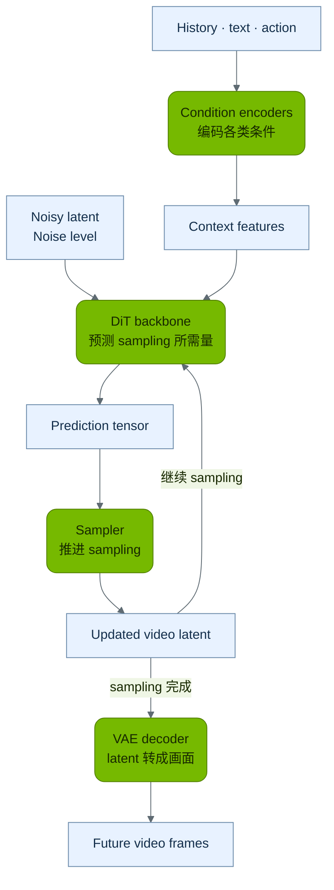

*图 1 一种 latent video generation 系统的模块结构。Condition encoders 提供 context features，DiT backbone 提供 prediction tensor，sampler 形成更新后的 video latent；sampling 完成后，VAE decoder 将 latent 还原为画面。继续或结束 sampling 是操作条件。*

**在这条路线中，不需要另设一个叫“world model”的神秘网络，再把结果交给完全独立的 video model。** conditional video generation 系统本身承担世界预测；其中学到的 dynamics，主要体现在 generative backbone 的参数，以及它如何利用历史和 action conditioning。VAE 主要负责视觉内容的 encoding 与 decoding，sampler 则按数值更新规则反复调用 generative backbone。

### 为什么 DIAMOND 是 pixel space 而图 1 是 latent space

**diffusion model 不必运行在 compressed latent space。** 要区分两者，应看加 noise、进行 sampling 的那个变量，究竟是图像 pixels，还是经过独立 encoder 压缩后的 latent。[Latent Diffusion 论文](https://arxiv.org/abs/2112.10752)

在 DIAMOND 的主实验中，被扰动和生成的变量就是下一张 image observation。模型把过去的 frames 与 noisy next frame 按 channels 拼接，送入 U-Net 2D，并用 action 与 noise level 作为 conditioning；它没有先把生成目标变成 VAE latent 再做 diffusion。这就是这里说的 pixel-space prediction。[DIAMOND 第 2.3 节与 Appendix D](https://arxiv.org/html/2405.12399#S2.SS3)

| 比较项 | DIAMOND 的 pixel-space 路线 | 图 1 的 latent-space 路线 |
| --- | --- | --- |
| 加 noise 的对象 | 下一 frame 的 pixel tensor | 未来视频的 VAE latent |
| Sampling 中反复变化的变量 | Noisy image observation | Noisy latent |
| Sampling 完成后 | 得到 image observation | 由 VAE decoder 还原 video frames |
| Backbone 内部 | 仍可有 feature maps 与 downsampling | 同样可以有 feature transformations |

**U-Net 内部存在 feature maps，不等于整个 diffusion 过程运行在 VAE latent space。** 前者是一次 forward pass 中的中间计算；后者是每次 sampling step 都在迭代的生成表示。把图片 resize 成较低 resolution，也仍可能是在 pixel space 做预测。DIAMOND 的 CS:GO 扩展就采用先低 resolution 预测、再由另一个模型 upsample 的路线。[DIAMOND 作者的方法说明](https://diamond-wm.github.io/#scaling-to-csgo)

## 一次预测从输入到输出发生了什么

**第一步 编码已经知道的信息。** 历史画面先转换为模型使用的 features 或 latent；文字和 action 也变成数值 representation。action 不是写在画面外的一条说明，而是生成网络实际读取的 conditioning。例如，相机向前移动和向后移动，应当提供不同的控制输入。

**第二步 为尚未生成的未来准备初始 representation。** 在常见 latent diffusion model 或 flow matching model 中，未来视频的 latent 从随机 noise 开始。过去的 observation 是已知 conditioning，未来的 noise 是待求解的内容，两者不能混为一谈。[Latent Diffusion 论文](https://arxiv.org/abs/2112.10752)

**第三步 在 conditioning 约束下逐步生成 future latent。** generative backbone 读取当前带 noise 的 representation、noise level、历史信息和控制条件，预测 sampling 所需的量。diffusion model 可以预测 noise、clean data 或其他等价的 parameterization；flow matching model 常预测 vector field。sampler 据此更新 representation，并再次调用网络，直到完成设定步骤。[DDPM 论文](https://arxiv.org/abs/2006.11239)、[Flow Matching 论文](https://arxiv.org/abs/2210.02747)

**第四步 解码并继续。** 在本例的 latent-space 路线中，VAE decoder 将生成的 latent 转成 video frames。若系统支持 streaming interaction，生成的内容会参与下一轮 context，新的操作也会进入下一轮预测。模型可以保留已有 latent 或 cache，不必每轮重新 encode 全部历史。DIAMOND 的 pixel-space 路线则直接得到 image observation，不需要这一 VAE decoding 步骤。

### DIAMOND 怎样直接在 pixel space 预测

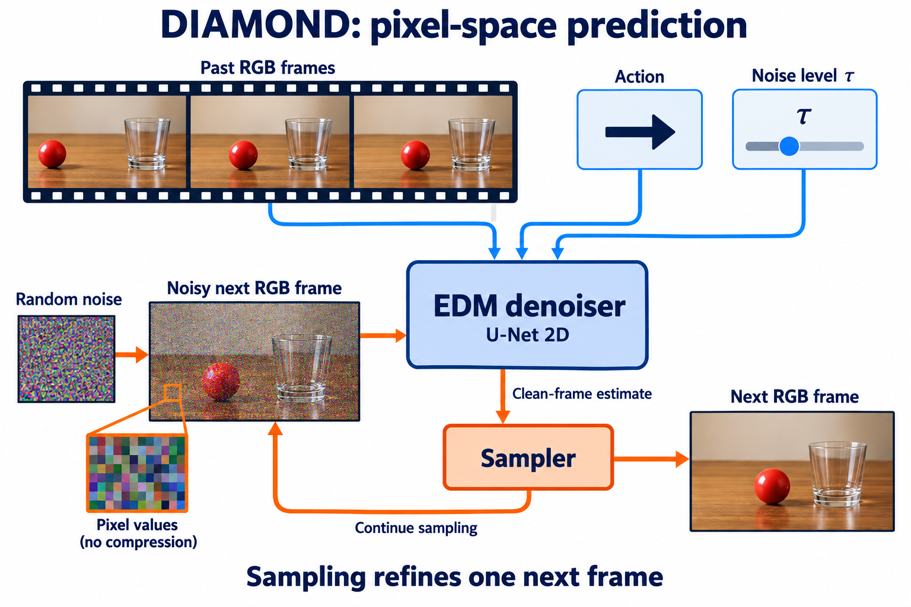

*沿用红球与杯子的场景解释 pixel-space 路线。上方的 history、action 与 noise level 是 conditioning；下方的 sampling loop 反复细化同一个 next frame。DIAMOND 的真实游戏场景演示见后文官方示例。*

DIAMOND 使用 pixel-space diffusion：**待生成的变量本身就是下一张 RGB image 的数值**。它从 random noise 开始，将当前 noisy next frame、past RGB frames、action 和 noise level 送入 EDM denoiser；denoiser 采用 U-Net 2D，给出 clean-frame estimate，sampler 再据此更新 noisy image，直到得到 next observation。要继续预测更远的未来，就把生成的 frame 放入新的 history，再预测下一 frame。[DIAMOND 方法说明](https://diamond-wm.github.io/#how-does-it-work)、[论文架构与 sampling](https://arxiv.org/html/2405.12399v2)

这里的 **pixel space** 是说 sampling 所更新的对象是 image values，省去了 latent diffusion 中先生成 compressed VAE code、再经 VAE decoder 还原图像的步骤。U-Net 内部仍有 feature maps、downsampling 和 upsampling；这些网络内部运算，与在 VAE latent space 中定义生成变量是不同层面的设计。

用同一组记号比较两条路线，就不会把 compressed latent 与 pixels 混在一起：

**Latent-space 路线**

```math
p_\theta\!\left(Z^{+}\mid H_t,A^{+},c\right)
```

再由 decoder 将 future latent 转成 future observations。

其中 Z⁺ 是 future video 的 compressed VAE latent。Training 时，VAE encoder 可以把已知 future frames 编成这类 latent；inference 时，generative model 直接生成 future latent，再 decode 成画面。

**DIAMOND 的 pixel-space 路线**

```math
p_\theta\!\left(O^{+}\mid H_t,A^{+}\right)
```

这里生成的 O⁺ 直接是 RGB observations，不经过上述 VAE latent bottleneck。两条路线都可能用 diffusion 实现 conditional prediction；区别在于 sampling 更新的变量。

## 同样做 denoising 为什么预测任务仍然不同

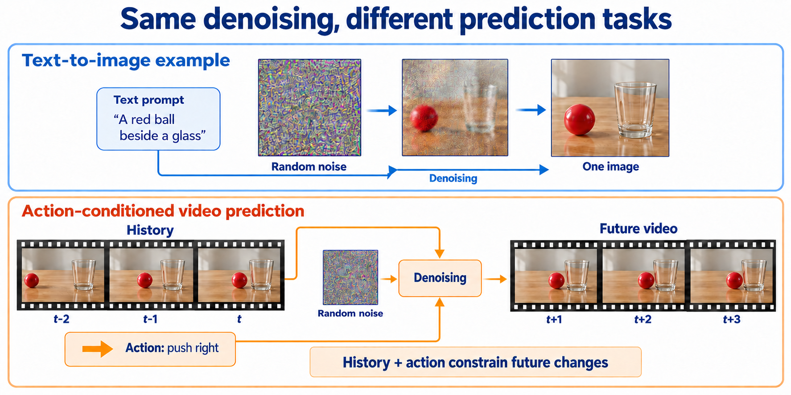

*上排的三个小图是同一张 image 的 sampling progress；下排右侧的三个 frames 是沿 environment time 展开的 future video。History 与 action 是 denoising network 的 conditioning，random noise 是独立的生成起点。*

先以常见 text-to-image 为例：输入“玻璃杯旁边有一个红球”，模型学习的是 `p_theta(image, given=text)`。它要生成符合描述的图像，但这个任务并未要求它根据之前几秒的运动，推断球下一刻会在哪里。Denoising 描述的是从 noise 得到样本的生成机制。[Latent Diffusion 的 conditional generation](https://arxiv.org/abs/2112.10752)

Action-conditioned video prediction 则学习 future video 在 history、actions 等条件下的分布：

```math
\begin{aligned}
&p_\theta\bigl(\text{future video}\mid\\
&\quad\text{history},\ \text{actions},\ \text{text}\bigr)
\end{aligned}
```

历史中球正向哪边运动、是否被挡住，以及现在施加什么 action，都会影响未来。模型必须在 training 时学会使用这些条件，在 inference 时也实际读取它们；单靠 denoising 这一步，不会自动形成历史 memory 或可靠的 action response。[DIAMOND 的 history 与 action conditioning](https://diamond-wm.github.io/#how-does-it-work)

例如，同一句“红球在杯子旁边”，可以对应球从左往右滚或从右往左滚的不同历史。Text-to-image 可以画出同样合理的一张图；要预测下一段视频，就需要利用能区分这两段历史的信息。若进一步改变 action，还应比较操作之后的未来是否相应改变。

Image editing 和 reference-conditioned image generation 也可以读取参考图；普通 video generation 也可以使用首帧或历史片段。区别要看模型**学习预测什么、读取哪些条件，以及输出能否保持时间与 action 的对应关系**，不能只按是否使用 diffusion，或是否输入了一张图来判断。

## 再放大看 generative backbone 内部

“Transformer 负责预测”仍然太抽象。可以进一步拆成输入 token、重复的 network blocks 和输出预测。token 在这里是把 video representation 切分并投影后得到的数值单元，不一定对应一个完整物体。

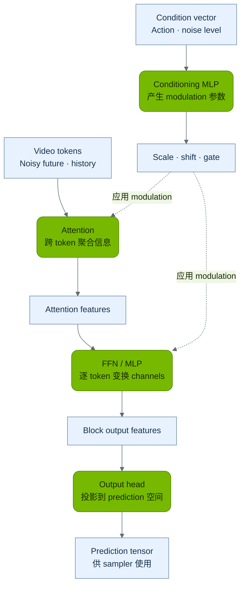

*图 2 以 adaLN-style conditioning 为例的 DiT 简化结构。Conditioning MLP 是模块，scale、shift、gate 是它输出的参数；调制是利用这些参数执行的操作。图中省略 normalization 与 residual connection 的具体连线，后文公式展示其作用位置。*

图中的几个模块可以分开理解。**Attention 做跨 token 的信息聚合**：让当前位置的预测参考其他位置、时间或 context 中的信息。**FFN / MLP 做逐 token 的 channel mixing 与 nonlinear transformation**，典型形式是：

```math
\operatorname{FFN}(x_i)
= W_2\,\operatorname{activation}\!\left(W_1x_i+b_1\right)+b_2
```

同一套变换分别作用于各个 token；FFN 本身不直接在 token 之间交换信息。Output head 再把最后的 features 投影到 prediction 所要求的维度。[Transformer 第 3.3 节](https://arxiv.org/html/1706.03762v7)、[DiT 的 final layer](https://github.com/facebookresearch/DiT/blob/main/models.py)

**Modulation 的目标，是让同一个网络根据条件改变这一次 prediction 的计算方式。** 在不同 noise level，模型面对的可用信号和需要恢复的细节不同；在不同 action 下，同一段 history 对应的 future 也可能不同。仅把这些条件写在输入说明中还不够，网络必须有实际使用它们的路径。原始 DiT 以 diffusion timestep 与 class label 为条件；WorldPlay 等 action-conditioned 系统进一步让 action 参与相应的 conditioning。[DiT conditioning 设计](https://arxiv.org/html/2212.09748v2#S3)、[WorldPlay action representation](https://arxiv.org/html/2512.14614v2#S3.S2)

以 adaLN / adaLN-Zero 为例，conditioning MLP 读取 condition embedding，产生各层使用的 `scale`、`shift` 与 `gate`。其中一种分支的计算可写成：

```math
u=\bigl(1+\gamma(c)\bigr)\odot\operatorname{LN}(x)+\beta(c)
```

```math
x'=x+\alpha(c)\odot F(u)
```

这里 γ、β、α 分别对应 scale、shift 和 gate，c 是 condition embedding，F 表示 attention 或 FFN 分支，⊙ 表示逐元素相乘。Scale 与 shift 改变 normalized feature channels 的幅度与偏置；gate 决定该 residual 分支贡献多少。这些 coefficients 通常在不同 token 位置共享、按 channel 变化。[DiT 官方实现](https://github.com/facebookresearch/DiT/blob/main/models.py)

**期望的行为影响**可以用转动相机理解：相同 history 下，向前走与向右转应使网络输出不同的 prediction，从而让 sampler 得到不同的后续视角；noise level 改变时，网络也应调整当前 sampling step 的预测。Training objective 会通过 prediction error 学习“条件 → coefficients → 合适输出”这条关系，并不存在人工指定的“向右转 feature channel”。Inference 时改变的是 coefficients 和 activations，已训练 weights 保持不变。能否正确响应某个 action，仍取决于训练数据和模型学到的对应关系。

这些运算共同学习历史、action 与未来之间的关系。另一种分工会显式引入 **physics engine**：用给定的物体几何、质量、摩擦与接触模型，通过数值求解推进位置、速度等 state，再交给 renderer 形成画面。推球时，它先计算球怎样运动或碰撞，renderer 再决定这些状态看起来是什么样。MuJoCo 就是这类 physics engine 的例子。[MuJoCo 官方介绍](https://mujoco.readthedocs.io/en/stable/overview.html#introduction)

因此，不能把普通 DiT 中的 attention 或 FFN 直接理解成一个内置的 physics engine。第 4 节与第 5 节还会介绍显式 state、engine 和 generative rendering 如何组合。

在 WorldPlay 的具体设计中，离散按键的 encoding 与 sampling-time embedding 结合，用于调制 DiT；连续 camera pose 通过 PRoPE 进入 self-attention。这里可以确切指出 action 进入网络的位置，而不只说“模型可以控制”。其 video generation 训练采用 flow matching。[WorldPlay 第 3 节及 architecture 图](https://arxiv.org/html/2512.14614v2#S3.S2)

## denoising steps 和 environment time 是两件不同的事

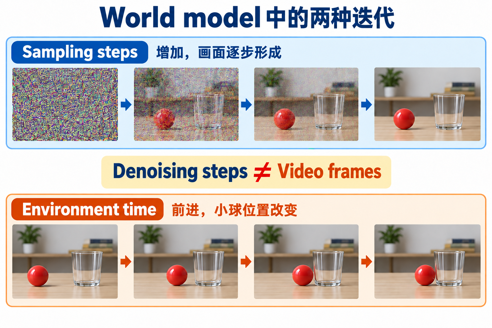

*上排展示同一目标画面从 noise 中形成的过程，下排展示场景随 environment time 变化。实际 video model 也可以一次共同生成多个 frame。*

**sampling time** 描述计算过程中的中间状态：对同一段尚未完成的视频，反复更新 representation，通常用 `noise_level` 或 noise level 标记。**environment time** 描述视频里的先后：球从一个位置运动到另一个位置，通常用 `t` 标记。

因此，30 次 sampling update 不意味着生成了 30 个 frame。一个模型可以用若干次 sampling update 生成一整 video chunk，再通过 autoregressive generation 继续生成下一块。**diffusion 或 flow matching 说明一块怎样生成，autoregressive generation 说明视频怎样继续。**

插图用 pixel noise 把计算过程可视化；latent model 实际更新的是 compressed tensor，而不是直接编辑人看到的 RGB 画面。也不能把生成中的每个中间图当作环境真实经历的 state。

# 4 模型怎样学会变化并持续运行

## 训练数据教的是条件和后续变化之间的关系

一个训练样本可以包含“过去的画面、执行的 action、action 之后的真实画面”。其中，过去画面与 action 是 conditioning，真实后续画面是需要学习预测的 ground truth。已有视频 pre-training 提供视觉与运动 prior，action-conditioned training 再建立控制输入与 future observations 的联系。

例如，记录一次推球过程：连续画面呈现球的位置变化，action record 给出何时执行了什么操作，后续 frames 记录真实结果。这里不要求每个模型都额外获得球的真实速度或质量标签；关键是把**历史、操作与结果**对齐。如果数据只有成片和笼统字幕，就较难确定精确 action 及其后果。把普通 video model 改造成交互 world model，需要相应的数据、接口与 training objective。

### 沿着小球训练图走一遍

下面选取一个具体的教学配置：使用已训练的 VAE 编码未来视频，固定 VAE，训练一个以 history 与 action 为条件的 latent diffusion predictor，并采用 noise prediction objective。

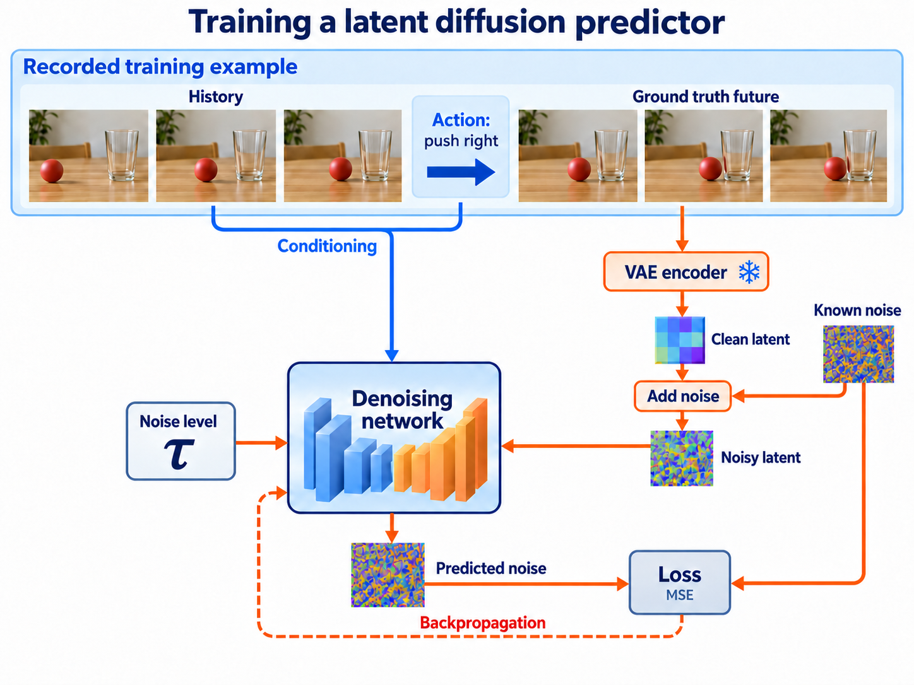

*上方是一条对齐的训练记录，下方是一次 supervised training step。实线表示数据流，虚线表示由 loss 产生的 backpropagation；VAE encoder 旁的雪花表示其 weights 保持固定。*

1. **准备一条训练记录。** History 是推球之前的连续画面，action record 是施加的操作，ground truth future 是操作之后真实拍到的 frames。前两者提供条件，后者提供监督。

2. **构造带 noise 的学习输入。** VAE encoder 把 ground truth future 编成 clean latent `z_0`。采样 `noise_level` 和一份已知的 random noise，按 noise schedule 混合 clean latent 与 noise。下方公式中的 τ 对应 noise level，ε 对应已知 noise：

**Forward noising**

```math
z_\tau=\alpha_\tau z_0+\sigma_\tau\epsilon
```

这里的 noise 是人为加入的，所以 training 时知道它的准确数值。

3. **让 network 预测这份 noise。** Denoising network 读取 `z_tau`、`noise_level`、history 与 action，输出 `predicted_noise`。Ground truth future 的 clean latent 不作为另一份干净的 conditioning 直接输入；它通过构造 noisy latent 和监督目标参与 training。

4. **计算 loss 并调整 weights。** 把 predicted noise 与同一份 injected noise 比较，得到 MSE，再通过 backpropagation 更新 denoising network 的可训练 weights。这里“更新”的是 training 参数；前面一次 forward pass 里的 FFN 则是在计算 features。

一次这样的 training step 通常采样某个 noise level 来学习，并不需要每次都完整执行一条多步 denoising chain。到了 inference，系统没有真实的 future frames 可读，而是从 noise 出发，反复调用训练好的 network 生成未来；history 与 action 仍是已知 conditioning。[DDPM 的训练与 sampling](https://arxiv.org/abs/2006.11239)、[Latent Diffusion 的表示路线](https://arxiv.org/abs/2112.10752)

上图采用常见的 **noise prediction objective**，通过预测 noise 与已知 noise 之间的 squared error 训练网络：

```math
\mathcal{L}
=\mathbb{E}\!\left[
\left\|\hat{\epsilon}_\theta(z_\tau,\tau,c)-\epsilon\right\|_2^2
\right]
```

ε̂θ 是 denoising network 的 predicted noise，ε 是加入的已知 noise，E 表示在 training samples 与采样的 noise 条件上取平均。这是一种具体 parameterization；clean-data prediction、velocity prediction 或 flow matching 会使用相应的 target。WorldPlay 的视频训练采用 flow matching，不能把上面的 noise-prediction 图当成它逐项相同的训练配置。[DDPM](https://arxiv.org/abs/2006.11239)、[Latent Diffusion](https://arxiv.org/abs/2112.10752)、[Flow Matching](https://arxiv.org/abs/2210.02747)

这些 objectives 让模型学习条件与后续数据之间的关系，并不等价于显式强制牛顿定律。能否稳定预测物理变化，还要看数据、模型设计与实际验证。

## 用 WorldPlay 看一个具体系统如何运行

WorldPlay 的官方实现提供基于 HunyuanVideo 的主要分支，以及基于 Wan 的较轻分支。官方将它描述为 streaming video diffusion model：以 action 作为 conditioning，逐 video chunk 生成后续视频，并从过去的片段中组织 context。下面按这一公开工作流，用“在虚拟房间里向前走，再转身”的例子说明。[官方实现与 inference 说明](https://github.com/Tencent-Hunyuan/HY-WorldPlay)

| 一轮交互中的环节 | 用户看到什么 | 系统内部在做什么 |
| --- | --- | --- |
| 建立起点 | 给出房间首帧和场景描述 | encode 视觉与文字 conditioning |
| 输入 action | 按键向前移动 | 把操作转为模型读取的控制 representation |
| 组织 memory | 不需要用户重新上传全部历史 | 保留近期 context；利用 camera pose 和 FOV overlap 为较早片段排序，读取被选中的历史 latent |
| 生成下一 video chunk | 看到向前移动后的连续画面 | conditional generative network 与 sampler 产生 future latent 再 decode |
| 转身并继续 | 新视角逐步出现 | 使用新的控制和更新后的历史，再次运行 |

### Memory retrieval 用什么来选择历史

这里可以给出比“找相关历史”更具体的回答。WorldPlay 的 HunyuanVideo inference 分支调用 `select_aligned_memory_frames`：保留近期 temporal context 与起始 chunk，再为更早的候选片段计算 geometric relevance，按分数选择 spatial memory，最后合并去重，读取对应的 context latent。[官方 retrieval 实现](https://github.com/Tencent-Hunyuan/HY-WorldPlay/blob/1588e1336e842b03b0a7860c654ebd7c46bb065e/hyvideo/utils/retrieval_context.py#L216)、[pipeline 中的调用](https://github.com/Tencent-Hunyuan/HY-WorldPlay/blob/1588e1336e842b03b0a7860c654ebd7c46bb065e/hyvideo/pipelines/worldplay_video_pipeline.py#L1114)

这个 scoring 利用 query 与历史视角的 camera pose，通过采样空间点估算 FOV overlap，并加入距离范围约束；重叠越大，候选片段越相关。Query 对应本轮要生成的视角，可以由控制轨迹提供，选择时无需先看到尚未生成的未来 RGB image。**这一 selector 是基于几何计算与排序的程序，没有单独训练的 semantic retrieval network。** 被选中的历史信息怎样影响输出，则由已训练的 video model 通过 attention 等运算学习。Camera pose 的获取、历史片段的选择、生成网络对 memory 的利用，是三个不同环节。[几何 scoring 函数](https://github.com/Tencent-Hunyuan/HY-WorldPlay/blob/1588e1336e842b03b0a7860c654ebd7c46bb065e/hyvideo/utils/retrieval_context.py#L139)

第 2 节“回头看沙发”的例子，展示的就是这里的 memory 分工：近期 chunks 提供连续运动线索，检索到的历史 frames 提供重访时的空间参考。WorldPlay 再通过 Context Forcing 等 memory-aware distillation 方法减少 sampling 所需的计算，并尽量保留利用长期 context 的能力。这里主要讨论 navigation 与 spatial consistency；物体接触、推球等 dynamics 仍需分别验证。[WorldPlay memory 与 distillation 方法](https://arxiv.org/html/2512.14614v2#S3.S3)

## 持续交互时反复使用的是同一套模型

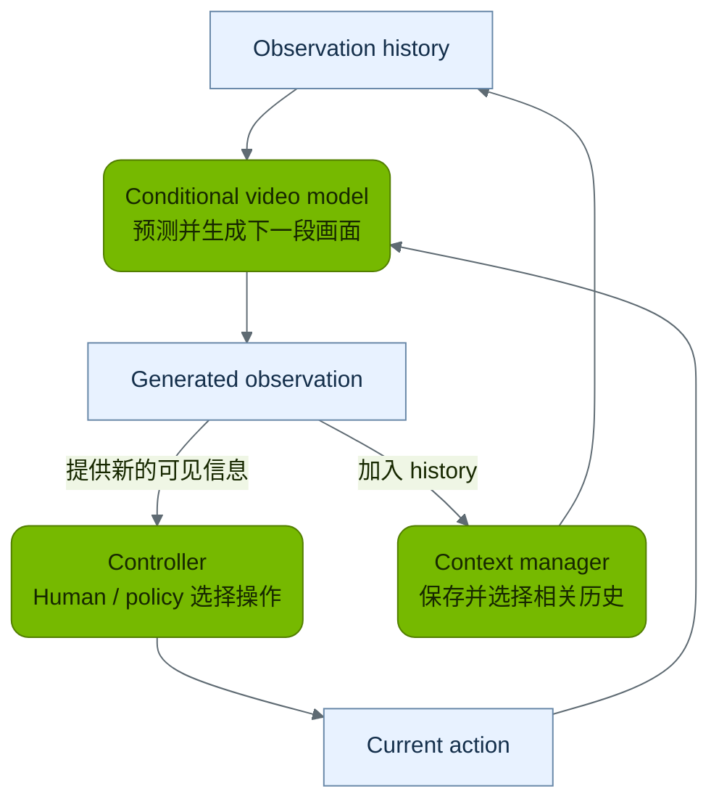

*图 3 虚拟世界中的模块交互。Controller 提供 action，conditional video model 生成 observation，context manager 保存并选择后续预测要读取的历史。各轮通常复用同一套已训练参数。*

在这样的虚拟交互中，下一轮使用的画面可以来自模型刚生成的结果。用户提供 action，模型生成相应 observation，再继续。这解释了“人进入模型生成的世界”的技术含义：**可见环境由 conditional generation 过程不断续写，交互输入参与决定续写方向。**

通常，每次按键并不会重新训练模型；改变的是输入、历史与 cache，训练好的参数保持不变。模型也可能因为早期预测有误而越走越偏。若用于真实机器人，真实传感器的 new observation 还需要进入系统以校正预测；模型自行生成的画面不能代替外界反馈。

policy 或 planner 负责决定做什么，world model 负责预测做了以后可能怎样。它们可以配合使用，也可以由人直接控制。DreamerV3 展示了在 imagined rollout 中学习 policy 的路线，policy 执行并不等于每步都在线穷举未来。[DreamerV3 Nature 论文](https://www.nature.com/articles/s41586-025-08744-2)

## 另一类 world model 确实把 state prediction 和画面 decoding 分开

现在可以回到更广的 world model 概念。有些方法先把 observation encode 成 internal representation，用单独的 dynamics model 预测下一 state，再由 decoder 重建画面。在这种分工中，dynamics prediction network 和 decoder 是不同模块；decoder 可以是普通 neural network，也可以采用更强的 generative model，具体取决于工作设计。

若 internal state `state_t` 已足够概括与预测相关的历史，可以把这类建模分成两个部分：

**State transition**

```math
p_\phi\!\left(s_{t+1}\mid s_t,a_t\right)
```

**Observation generation**

```math
p_\psi\!\left(o_{t+1}\mid s_{t+1}\right)
```

前者预测 internal state 怎样变，后者描述该 state 下会获得什么 observation。把历史压缩到 current state 是一种建模假设；它是否保留足够信息，需要检查，而不由“latent”这个名称保证。

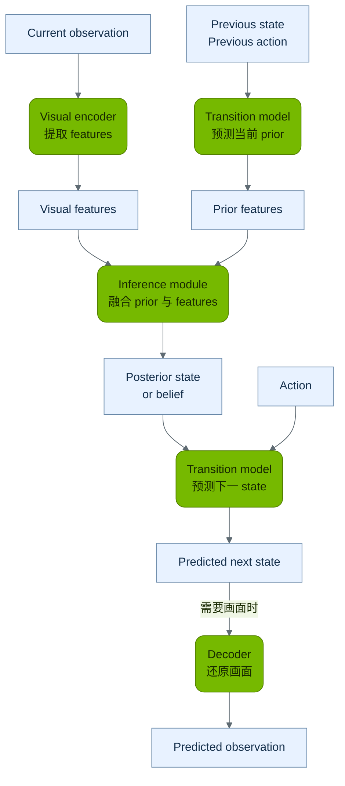

*图 4 带 state inference 的模块化路线。绿色模块负责计算，蓝色数据包含 observation features、prior、posterior 与 predicted state。为显示两个时间位置，同一 transition model 画了两次，通常共享参数。图中是功能划分；具体模型可共享部分实现，observation decoder 按任务需要使用。*

### Encoding 与 state estimation 分别解决什么问题

**Encoding** 解决“怎样把 observation 表示成网络能处理的 features”：例如把 RGB image `obs_t` 变成 `features_t = encoder(obs_t)`。**State estimation** 解决“结合现在看见的内容与过去的线索，此刻最可能处于什么状态”：例如球暂时被杯子挡住时，当前 image 本身看不到球，但历史运动仍可帮助推断它的位置。若信息不足，合理的表示还应容纳多种可能性；这种关于隐藏状态的分布可称为 belief。

在带 latent state inference 的方法中，可以用下面两种 conditional distribution 表示 observation update 与 future prediction：

**Observation update**

```math
q_\phi\!\left(s_t\mid\text{history},e_t\right)
```

**Future prediction**

```math
p_\theta\!\left(s_{t+1}\mid s_t,a_t\right)
```

前者读取已经到来的 observation features，后者预测尚未看到的未来。PlaNet / Dreamer 的 recurrent state-space model（RSSM）体现了“有 observation 时更新 state、想象未来时使用 transition prior”的分工。Encoder 是 inference 的输入来源之一；state inference 还会结合 recurrent history 等信息。[PlaNet 的 latent dynamics 与 inference](https://arxiv.org/abs/1811.04551)、[Dreamer 的 representation 与 transition model](https://arxiv.org/abs/1912.01603)

2018 年的 World Models 与 V-JEPA 2 可以帮助我们把这些功能对应到真实架构。第 2 节的 World Models 官方图中，VAE 提供 `z_t`，MDN-RNN 提供 recurrent history `h_t` 并预测 next `z` 的分布，controller `C` 决定 action；它并没有一个必须单独命名为“state estimator”的模块。V-JEPA 2 则先学习 video representation，后续的 **V-JEPA 2-AC** 再学习 action-conditioned future prediction。二者都使用 internal representation，但 representation 的 training objective 和使用方式不同。[World Models 原文](https://worldmodels.github.io/)、[V-JEPA 2 论文](https://arxiv.org/html/2506.09985v1#S1.F2)

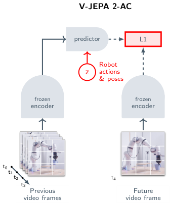

*V-JEPA 2 论文 Figure 2 右图，作者 Assran 等，2025。图示为 V-JEPA 2-AC 的 training：past frames 经 frozen encoder 后进入 predictor，robot actions 与 poses 作为条件；future frame 经同一 frozen encoder 得到 training target，L1 比较两个 representations。图片来自 [论文原图与图注](https://arxiv.org/html/2506.09985v1#S1.F2)。*

读这张图时，最容易误解的是右侧的 future frame：**它在 training 中提供 target，inference 时无需预先知道未来画面。** Predictor 需要从已有 representation 和候选 actions 预测未来 representation。V-JEPA 2 的 actionless pretraining 采用 masked representation prediction；V-JEPA 2-AC 在冻结 encoder 后学习 action-conditioned predictor。用于 robot planning 时，再比较 predicted representation 与 goal representation，通过 model predictive control（MPC）选择 action 并根据新 sensor observation 重新规划。[V-JEPA 2-AC 与 planning](https://arxiv.org/html/2506.09985v1#S3)

| 比较维度 | World Models 2018 | V-JEPA 2 与 V-JEPA 2-AC |
| --- | --- | --- |
| Representation 怎样学到 | VAE 利用 image reconstruction 学习 visual code `z` | V-JEPA 2 利用 masked representation prediction 学习 encoder |
| Action-conditioned prediction 预测什么 | MDN-RNN 预测 next VAE code 的概率分布，并维护 recurrent state | V-JEPA 2-AC predictor 预测 future frame representations |
| 是否需要生成可观看画面 | VAE decoder 可将 sampled code 还原为图像 | 该 prediction objective 无需输出 pixel reconstruction |
| 怎样用于 control | Controller 读取当前 `z` 与历史 `h` 决定 action | 用 predicted representation 与 goal representation 做 MPC |

这也说明“采用 video representation”并不等于“生成 video”。Video generator 可以直接预测未来画面；representation predictor 也可以为 planning 提供有用的预测，而无需把每个 imagined future 都渲染出来。

| 实现路线 | 变化主要在哪里计算 | 画面怎样产生 |
| --- | --- | --- |
| conditional video generation | 生成网络结合历史与 action 预测 future observations | 同一个 conditional generation 流程输出视频 |
| internal state prediction | dynamics network 先预测 representation 或 state transition | decoder 按需还原 observation |
| explicit state 与规则 | engine 或程序维护位置 规则和事件 | renderer 或 generative model 根据 state 出图 |

这些路线也可以组合。最有用的阅读方法是明确指出：**哪个模块预测变化，哪个模块产生画面，什么信息被保存，action 究竟进入哪里。**

## 回看三种使用方式

下方可以切换 video continuation、action-conditioned prediction 和 closed-loop interaction。前两项描述一次 prediction 读什么、输出什么；closed loop 描述结果和下一次 action 怎样进入后续轮次。“Model prediction”对应前面具体的 network、conditioning 和 sampling 过程。

Closed loop 还需要区分 **observation 的来源**。在 WorldPlay 这类 virtual generated world 中，人或 policy 提供 action，world model 生成下一 observation，生成结果加入 history 后继续。在真实机器人中，模型预测用于辅助决策，action 由真实执行器作用于外界，随后由传感器重新测量得到 observation。下方真实环境路线以 model-based planning 为例；生成画面与真实 sensor feedback 在系统中承担不同作用。[WorldPlay inference](https://github.com/Tencent-Hunyuan/HY-WorldPlay)、[V-JEPA 2 planning](https://arxiv.org/html/2506.09985v1#S4)

<iframe class="demo" title="Video continuation Action conditioning 与两种 Closed loop" src="assets/demo-10.html" loading="lazy" sandbox="allow-scripts allow-same-origin allow-popups allow-popups-to-escape-sandbox"></iframe>

[单独打开演示](assets/demo-10.html)

# 5 video generation 方向的最新 world model 工作

## 从 latent dynamics 到 interactive video 的发展时间线

下图选取 **2015—2026 年的 37 个 world model 代表节点**，覆盖 action-conditioned environment prediction、latent dynamics 与 control、interactive world simulation、physical AI 平台，以及 explicit state 与 generative rendering 的组合。这条时间线关注明确学习或维护环境表示与变化、用于预测行动后果、交互模拟或 planning 的工作；通用 video generation 的进展放在相关技术背景中讨论。更广的 model-based learning 与 simulation 研究仍有更早的历史。

时间轴仅显示四位年份，节点日期为 MM-DD。左列为 **Control / representation 等工作**，右列为 **Video 相关工作**。颜色小点是可重叠的研究方向标签：以视觉未来预测或交互画面生成为主要内容的节点放右列，交叉工作显示两个小点；以 representation 服务 control 或 planning 为主的工作放左列。Diffusion Forcing 作为连接 sequence prediction 与 model-based planning 的方法节点列入。论文日期取首次 arXiv 提交，项目 release 日期取官方公告；节点间距不表示时长，位置不表示直接继承关系。

<iframe class="demo" title="World Model 发展时间线" src="assets/demo-11.html" loading="lazy" sandbox="allow-scripts allow-same-origin allow-popups allow-popups-to-escape-sandbox"></iframe>

[单独打开演示](assets/demo-11.html)

**为什么 Genie 重要：它从视频中学出了可用的控制接口。** 以一段 2D platformer 录像为例，画面里角色先移动、再跳起，但没有记录玩家按过什么键。Training 时，latent action model 根据已有 frames 与下一 frame 的变化学习少量 discrete action codes；dynamics model 再学习“history + action code → next frame”。Inference 时，用户选择 code，模型便生成相应的后续画面。论文实验使用 8 种 latent actions，它们的效果可由使用者探索并映射到控制按钮。[Genie 论文第 2.1 与 2.2 节](https://arxiv.org/html/2402.15391v1#S2)

它的重要性在于，**训练可交互模型所需的数据，不必都附带真实 action annotations**：大量只有画面的互联网视频也能成为学习来源。学到的 codes 是用于控制预测的 latent categories，并不保证还原录像中真实的键盘操作；但它们让用户能够持续影响生成轨迹。Genie 的主要展示基于 2D platformer，因此这一进展应理解为从无 action 标注的视频学习可控环境的一条路线，而不是已经获得通用、可靠的 physics engine。[Google DeepMind 的研究说明](https://deepmind.google/research/publications/60474/)、[论文数据与 inference 说明](https://arxiv.org/html/2402.15391v1#S3)

2015 至 2023 年 prediction、control 与 simulation 来源：[Action-Conditional Video Prediction](https://arxiv.org/abs/1507.08750)、[Recurrent Environment Simulators](https://arxiv.org/abs/1704.02254)、[World Models](https://worldmodels.github.io/)、[PlaNet](https://arxiv.org/abs/1811.04551)、[SimPLe](https://arxiv.org/abs/1903.00374)、[MuZero](https://arxiv.org/abs/1911.08265)、[Dreamer](https://arxiv.org/abs/1912.01603)、[DreamerV2](https://arxiv.org/abs/2010.02193)、[IRIS](https://arxiv.org/abs/2209.00588)、[DreamerV3](https://arxiv.org/abs/2301.04104)、[GAIA-1](https://arxiv.org/abs/2309.17080)、[UniSim](https://arxiv.org/abs/2310.06114)、[TD-MPC2](https://arxiv.org/abs/2310.16828)。

Sequence prediction 与 planning 方法来源：[Diffusion Forcing](https://arxiv.org/abs/2407.01392)。它同时研究 video prediction、长时 rollout 与 model-based planning。

2024 年 world model 来源：[Genie](https://arxiv.org/abs/2402.15391)、[DIAMOND](https://arxiv.org/abs/2405.12399)、[iVideoGPT](https://arxiv.org/abs/2405.15223)、[GameNGen](https://arxiv.org/abs/2408.14837)、[Oasis](https://oasis-model.github.io/)、[DINO-WM](https://arxiv.org/abs/2411.04983)、[Genie 2](https://deepmind.google/blog/genie-2-a-large-scale-foundation-world-model/)。

2025 至 2026 年来源：[Cosmos](https://arxiv.org/abs/2501.03575)、[V-JEPA 2](https://ai.meta.com/blog/v-jepa-2-world-model-benchmarks/)、[Genie 3](https://deepmind.google/blog/genie-3-a-new-frontier-for-world-models/)、[Matrix-Game 2.0 论文](https://arxiv.org/abs/2508.13009)、[Matrix-Game 2.0 与 4.0 发布记录](https://github.com/SkyworkAI/Matrix-Game#news)、[Dreamer 4](https://arxiv.org/abs/2509.24527)、[PAN](https://arxiv.org/abs/2511.09057v1)、[WorldPlay](https://arxiv.org/abs/2512.14614)、[Waymo World Model](https://waymo.com/blog/2026/02/the-waymo-world-model-a-new-frontier-for-autonomous-driving-simulation/)、[DreamDojo](https://arxiv.org/abs/2602.06949)、[Cosmos 3](https://arxiv.org/abs/2606.02800)、[LingBot-World 2.0 / Infinity](https://arxiv.org/abs/2607.07534)、[Atlas](https://www.worldlabs.ai/blog/atlas)、[GWM Worlds 2](https://runway.com/research/introducing-gwm-worlds-2)、[Programmable World Model](https://arxiv.org/abs/2609.10540)、[StreamRender-H3 项目介绍](https://nvlabs.github.io/Sana/Sol-Engine/StreamRender-H3/)。StreamRender-H3 节点日期采用作者在 [RAVEN 仓库 News](https://github.com/mvp-ai-lab/RAVEN#news) 中的 2026 年 10 月 12 日公告。

沿 video / interaction 这条线看，早期工作在特定游戏里预测 action 之后的画面，后续研究逐步推进到可连续操作的生成环境，并处理重访场景时的一致性、更丰富的事件和视听变化。Genie、DIAMOND 与 WorldPlay 以不同方式把 action 纳入 future prediction。Control / representation 路线仍在并行发展，V-JEPA 2-AC 展示了不依赖 pixel video 输出的 planning 方式。

截至 2026 年 10 月，值得关注的变化是：研究正在同时推进**interactive video、spatial consistency、multimodal simulation，以及 executable state 与生成画面的结合**。下面按要解决的问题介绍代表工作，先看能力，再看模型名字。

阅读时，可以沿用前面的四个问题：哪个模块预测变化，哪个模块产生画面，保存了什么信息，action 进入哪里。以下按公开展示的功能介绍；具体 network architecture 以各工作的论文或实现为准。

下文涉及的分辨率、帧率和时长均对应各团队公开的特定版本或演示条件。它们不能直接组成速度或综合能力排名；开放代码、开放权重、在线产品和研究预览也具有不同含义。

## 先看一张能力地图

| 方向与代表工作 | 主要解决什么问题 | 对 video generation 有什么意义 |
| --- | --- | --- |
| Genie 3 与 Project Genie | 根据操作持续生成可探索环境 | 从看影片走向进入并探索影片 |
| GWM Worlds 2 | 实时响应角色 action 场景事件和 camera control | 把连续视听生成变成可操控媒介 |
| Atlas | 用明确 spatial context 和 camera control 生成 | 提高镜头设计和跨视角一致性 |
| LingBot World Infinity 与 AlayaWorld | 长时交互 memory 和 streaming generation | 减少连续操作中的漂移与遗忘 |
| Cosmos 3 | 统一理解 视听生成和 action 建模 | 为 physical AI 提供生成与预测基础 |
| Waymo World Model 与 GAIA 4 | 生成驾驶传感器未来并进行模拟 | 强调 action 后果和 closed-loop validation |
| Programmable World Model 与 Matrix Game 4.0 | 用显式规则维护 state 用 generative model 呈现画面 | 把规则可靠性与视觉表现分别设计 |

## Genie 3 从生成片段走向可探索环境

Google DeepMind 于 **2025 年 8 月 5 日**公布 Genie 3。其研究展示可以从文字描述生成可实时导航的环境，报告在 720p、24 fps 下保持数分钟的一致性。你持续移动和转动视角，后续画面随操作产生。[Genie 3 官方介绍](https://deepmind.google/blog/genie-3-a-new-frontier-for-world-models/)

**对初学者最值得观察的现象**是：走过一个地方、转身、再回来，场景是否仍能对上。这比只看一段向前移动的漂亮视频，更能暴露 spatial memory 问题。

这里要区分研究模型和体验产品。**Project Genie 于 2026 年 1 月 29 日开放实验原型，5 月 19 日进一步扩展**；5 月公告还加入了以美国 Street View 地点作为起点的能力。首发原型列有 60 秒生成、控制延迟和物理错误等限制，不能直接套用 Genie 3 研究展示的全部能力。体验资格以产品当前地区和账号条件为准。[Project Genie 首发与限制](https://blog.google/innovation-and-ai/models-and-research/google-deepmind/project-genie/)、[2026 年 5 月扩展](https://blog.google/innovation-and-ai/models-and-research/google-deepmind/project-genie-expands/)

## GWM Worlds 2 把视听生成变成可操控的连续过程

Runway 于 **2026 年 9 月 3 日**公布 GWM Worlds 2 研究预览。它将持续世界描述、首帧、带时间的文字 action 和相机输入组合起来，生成可连续交互的视听内容；官方报告 720p、24 fps 视频与 48 kHz 音频。用户可以操控角色，也可以改变场景事件，例如让灯亮起或天气变化。[GWM Worlds 2 官方研究说明](https://runway.com/research/introducing-gwm-worlds-2)

它对视频创作的启发是：**“拍什么”和“什么时候发生什么”可以成为更明确的控制接口。** 相比一次写完 prompt，创作者有机会在生成过程中继续导演。

官方同时说明，快速相机运动会损伤纹理和几何，long-term memory 仍不完善；预先编排丰富 action 的生成，通常比临时按键式操作效果更好。“可以持续生成”因此不能解读成“无限时间绝不漂移”。目前其定位为研究预览，官方页面提供联系入口。[同一研究说明的限制与演示条件](https://runway.com/research/introducing-gwm-worlds-2)

## Atlas 把 camera control 放进 spatial context

World Labs 于 **2026 年 9 月 1 日**公布 Atlas。它原生处理文字、图像、camera pose 与深度等信息，用共同的 spatial context 生成新视角和视频；官方展示了由少量参考图与设计好的 camera trajectory 生成最长 1 分钟、1440p 视频，也展示 point cloud 与 3D Gaussian splats 等显式三维输出。[Atlas 官方技术介绍](https://www.worldlabs.ai/blog/atlas)

对关注 video generation 的人来说，关键区别是：镜头运动可以用**相机的位置与朝向**来表达，而不仅依赖“慢慢向左移动”这样的自然语言。你可以围绕同一个场景设计多个镜头，并追问它们的几何关系是否一致。

输入没有覆盖的区域仍需要模型补全，因此新生成的背面和画外空间可能是合理想象。精确相机接口也不自动保证所有动态物理交互正确。Atlas 公告的获取方式是面向部分合作伙伴的早期访问。[Atlas 空间补全与访问说明](https://www.worldlabs.ai/blog/atlas)

### 相关方法 GEN3C 与 3D cache

**GEN3C 研究怎样利用显式空间信息改善 camera-controlled video generation。** 它的 3D cache 是一组 colored point clouds：先估计输入图像或已有 frame 中各像素的 depth，再将这些像素放回三维空间，保存其位置与颜色。不同时间、不同 camera view 可以对应不同的 point cloud。[GEN3C 第 4.1 节](https://arxiv.org/html/2503.03751v1#S4.SS1)

当用户指定新的 camera pose，系统先渲染已有 3D cache，得到一个可能有空洞与误差的画面，再用 video model 修正并补全。例如，先看见沙发、随后转动镜头，保存的三维信息就能为沙发在新视角下的位置提供参照。这里的贡献是 spatial consistency 与 camera control；学习完整的 action-conditioned environment dynamics 仍是另一个问题。[GEN3C 的 cache rendering 与 conditioning](https://arxiv.org/html/2503.03751v1#S4.SS2)

## 开放交互视频路线把memory和速度做成可研究的问题

**LingBot-World 2.0 也称 LingBot-World-Infinity，2026 年 7 月发布，9 月进一步补齐模型变体。** 官方提供多种权重和 inference code，扩展了移动之外的角色 action 与文字事件，并报告 distillation 版本的 720p、60 fps 能力。它展示了操控角色与操控环境相结合的方向。参考运行条件涉及多 GPU，不能据此推断普通单卡都能达到相同速度。[LingBot 官方仓库与发布记录](https://github.com/Robbyant/lingbot-world-v2)

**AlayaWorld 于 2026 年 7 月公布，8 月推出 v1.1 并开放代码与权重。** 它用分块 autoregressive video generation 配合 spatial memory，支持 camera control 和生成中途改变提示；v1.1 的一个重点是利用streaming 3D point cache组织空间线索。项目开放了训练与 inference code、模型及部分数据，适合进一步研究“回头为什么还能看到同一地方”。[AlayaWorld 官方仓库](https://github.com/AlayaLab/AlayaWorld)、[v1.1 论文](https://arxiv.org/abs/2608.13492)

**HY-WorldPlay** 是另一个有用的开放案例。它于 2025 年底公布，并在 2026 年持续开放训练与 post-training 代码，组合 action conditioning、context memory 和 distillation。它有助于理解：把 video model 变成可交互世界，往往需要数据、memory、生成方式和 inference acceleration 一起改变。项目中的不同大小版本存在画质与资源取舍。[HY-WorldPlay 官方仓库](https://github.com/Tencent-Hunyuan/HY-WorldPlay)

这些项目的价值不仅在演示效果，也在于公开了部分研究材料。阅读时应继续确认你看的具体版本、许可证、权重、显存和硬件要求；“开放”本身并不保证适合个人电脑运行。

## Cosmos 3 从 video generation 走向 multimodal world modeling

NVIDIA 于 **2026 年 6 月 1 日**发布 Cosmos 3。它采用统一的 Mixture-of-Transformers 架构，将语言、图像、视频、音频和 action 纳入同一模型体系。官方演示覆盖视听生成、依据 action 预测 future observations，以及从变化反推 action 等任务。[Cosmos 3 论文](https://arxiv.org/abs/2606.02800)、[Cosmos 3 官方研究项目](https://research.nvidia.com/labs/cosmos-lab/cosmos3/)

可以把它理解为：既关心生成世界的外观，也关心在 physical AI 工作流中如何使用预测。典型用途包括扩充训练场景、构造不同未来，以及研究机器人或车辆的 action 后果。

Cosmos 3 提供代码和模型材料；当前文档区分 Reasoner 与 Generator 等运行接口。它是一个模型家族，具体下载版本支持哪些模态、控制和任务，需要逐项对应；不能把整个家族的展示能力都归到任意一个模型文件上。[Cosmos 3 当前文档](https://docs.nvidia.com/cosmos/latest/cosmos3/index.html)

## Waymo 与 GAIA 4 用驾驶说明 closed loop 为何重要

**Waymo World Model 于 2026 年 2 月 6 日公布**，基于 Genie 3 面向驾驶场景训练，输出不仅包括相机视频，也包括 lidar（激光雷达），并提供驾驶 action、布局和语言等控制方式。它关心的是“换一种行驶方式或环境条件，传感器接下来会看见什么”。[Waymo 官方介绍](https://waymo.com/blog/2026/02/the-waymo-world-model-a-new-frontier-for-autonomous-driving-simulation/)

**Wayve GAIA-4 于 2026 年 8 月 3 日公布**，重点展示 closed loop：AI Driver 的刹车和转向，改变下一步生成的 observation；系统结合相机与 radar（雷达）。它既可以约束其他交通参与者按记录行动，也可以启用会响应本车的参与者。[GAIA-4 官方介绍](https://wayve.ai/thinking/gaia-4/)

closed loop 的意义是，控制系统必须面对自己行动造成的新局面。若系统无论怎么打方向盘，都只观看同一段预录视频，就不能检验这种能力。上述工作面向专门驾驶验证场景，其发布说明不能当作面向创作者的通用视频工具下载入口。

## executable state 加 generative rendering 是一条值得留意的新路线

纯生成方案需要学习画面背后的 state；另一条思路是先明确保存 world state 与规则，再让 video model 负责视觉呈现。

**Programmable World Model 于 2026 年 9 月提出，10 月更新论文**：它把 world state 演化和视觉生成拆开，用可执行程序与轻量 engine 维护包括画面外实体在内的 state，再把 state 和 camera trajectory 转成 video model 的 conditioning。它提醒我们：生命值、物品数量、关卡规则等，不一定都要寄希望于 pixel model 自行记牢。[作者论文](https://arxiv.org/abs/2609.10540)

**Matrix-Game 4.0 的官方仓库于 2026 年 10 月 15 日宣布发布**，采用 game engine 负责玩法、物理和输入，causal video model 将低细节 RGB 画面转成更丰富的视觉输出。它是引擎与 neural rendering 的混合方案；官方列出的验证配置包含 A100 80GB，“单 GPU”不等于普通消费卡即可运行。作为当天的新发布，应结合后续复现观察其实际边界。[官方发布记录](https://github.com/SkyworkAI/Matrix-Game)、[4.0 实现与运行说明](https://github.com/SkyworkAI/Matrix-Game/blob/main/Matrix-Game-4/README.md)

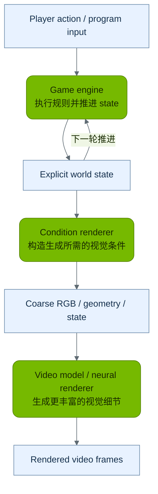

*图 5 Engine 与 generative rendering 的模块组合。Game engine 执行规则并输出 explicit world state，condition renderer 将其转成所需条件，再由 video model 或 neural renderer 形成画面。不同项目使用的 state 和 conditioning 形式有所不同。*

## 生成与编辑视频本身也在继续发展

与上述世界模拟路线相邻，Gemini Omni Flash 的 2026 年模型卡描述了 multimodal 输入、带音频视频输出以及对话式视频编辑，同时列出编辑一致性和复杂运动等限制。它体现了视频工具向持续修改与更强条件理解发展。[Gemini Omni Flash 模型卡](https://deepmind.google/models/model-cards/gemini-omni-flash/)

Sora 2 则是 2025 年视频与音频生成的重要研究案例；其官方系统卡注明，Sora 产品自 **2026 年 4 月 26 日**起不再提供，因此这里把它作为历史研究脉络，不作为当前体验入口。[Sora 2 系统卡与产品状态](https://openai.com/index/sora-2-system-card/)

对初学者来说，实用的区分是：**生成或修改一段视频、控制镜头探索场景、持续操控世界中的事件，分别需要不同的能力和接口。** 阅读任何“world model”发布时，都可以先问它具体完成了哪一种。

# 6 world model 还没有解决哪些问题

## 好看和正确需要分别验证

视频可以很有电影感，却出现物体数量改变、接触后没有合理反应、液体流动异常等问题。物理评测的目的，就是避免用整体观感掩盖这些细节。

PhyGenBench 用一组物理规律与提示评估 video generation；受控二维运动研究则专门改变速度与物体组合，检查模型能否外推。它们支持的启发是**把评估条件说清楚，主动测试新情形**，并不能作为对所有 2026 年模型的总判决。[PhyGenBench 正式论文](https://proceedings.mlr.press/v267/meng25c.html)、[物理泛化研究](https://arxiv.org/abs/2411.02385)

## action conditioning 不等于已经建立可靠 causal model

把“向右推”输入模型，得到向右运动的画面，证明模型能够跟随某类条件。若要进一步用于预测真实干预，还需要确认它是否见过相关 action 与后果，能否区分隐藏因素，以及在新设置中是否仍准确。

因此，“如果当时换个行动会怎样”的生成结果，首先应理解为**模型给出的 conditional prediction**。要把它当作现实决策依据，还需要相应场景中的验证。

## long-term memory 需要保存什么

短期连续性可以依赖最近的视频；更长的探索还需要保存位置、场景结构、重要事件，以及没有出现在当前画面中的实体。spatial cache、explicit 3D representation、history retrieval 和 persistent state，是不同项目尝试的机制。它们也带来存储、算力、更新和错误修正成本。

generative model 还会进入自己创造的 state：如果早期把杯子生成错了，后续可能围绕错误继续编出连贯画面。**连贯的想象仍可能偏离真实环境**。这也是重新接收 observation、校正预测以及保留可验证 state 的重要原因。

# 7 如何看懂一个模型的演示和论文

看宣传视频时，可以带着下面八个问题。它们比先比较分辨率或参数量更有帮助。

| 问题 | 可以怎样观察 |
| --- | --- |
| 输入是什么 | 文字 图片 历史视频 camera trajectory 还是 action |
| 输出是什么 | RGB video depth radar action 还是 internal representation |
| 操作是否有效 | 改变一个 action 其余条件尽量相同 比较后续 |
| 世界是否被记住 | 离开再返回 检查位置 数量 身份与布局 |
| 物理是否合理 | 看接触 碰撞 遮挡 重力和 object permanence |
| 能否应对新情况 | 换速度 物体组合 镜头或操作范围 |
| 是否真正可交互 | 区分实时操作 预先编排和离线播放 |
| 能否复现或使用 | 查具体版本 权重 许可证 硬件与访问方式 |

还要区分三个经常都被写成“速度”的量：**playback frame rate** 描述视频怎样播放；**generation throughput** 描述系统每秒算出多少 frame；**interaction latency** 描述输入操作后多久看到响应。要公平比较，还必须对齐硬件、resolution、模型版本、sampling steps 和测量范围。

VBench-2.0 等评测开始把画质之外的人体表现、可控性、物理与常识纳入评价。没有单一指标能覆盖所有用途：创作者重视可编辑性和 camera control，游戏重视稳定操作与规则，机器人则更关心 action 后果与任务成功。[VBench-2.0 论文](https://arxiv.org/abs/2503.21755)

## 可以自己做的红球小实验

如果某个工具支持对应接口，可以从同一首帧或同一段历史开始，分别要求球继续滚动、停止，或者被挡板拦住。每次只改变一个控制，观察杯子、桌面和球的身份是否保持，结果是否随操作产生合理区别。

再试着让相机转开、转回，或改变初始速度。记录失败发生在哪里，往往比只挑最漂亮的一次输出更有收获。这个实验用于建立观察习惯，并不构成严格物理基准；尤其是只支持文字提示的工具，未必具有真正的物理 action 接口。

# 8 初学者可以怎样继续学习

**第一步 建立直觉**：看 Genie 3 的探索演示、Atlas 的 camera control 演示和 GWM Worlds 2 的交互演示。先分辨镜头变化、角色 action 和世界事件，再观察回头后的场景是否一致。

**第二步 看懂模型内部**：对照第 3 节，指出 condition encoding、DiT backbone、sampler 与 VAE 各自负责什么；再看第 4 节，分清训练、一次生成和持续交互，比较 video generation 与 internal state 预测两种实现。

**第三步 选一个方向深入**：关注视频创作，就看 camera control、参考图约束和持续编辑；关注实时世界，就看 action conditioning、memory、distillation 和延迟；关注机器人或驾驶，就看 closed loop、传感器输出和任务评测。

**第四步 再读论文**：先读摘要和方法总图，写下输入、输出、训练数据、控制方式、评测与限制六项。能用自己的话说明这六项，通常比一开始追逐所有公式更有用。

入门阶段不必急着部署最大的开放模型。先用项目演示理解能力边界，等目标明确后，再按具体模型卡核对资源与运行条件。

# 9 读论文时常见的术语

| 术语 | 通俗解释 |
| - | - |
| observation | 实际接收到的信息 例如相机画面 |
| state | 描述环境当前情况所需的信息 可能包含不可见部分 |
| latent | 未直接以原始输入形式呈现的变量或 representation 在不同系统中承担不同作用 |
| dynamics | 环境随时间和行动怎样变化 |
| action conditioning | 预测时明确输入 action 以约束后续变化 |
| rollout | 连续运行模型得到多步预测 |
| policy | 根据已有信息决定行动的模型或规则 |
| closed loop | 行动改变后续 observation 新 observation 再影响行动 |
| autoregressive generation | 根据已有内容继续生成后续内容 |
| diffusion model 与 flow matching model | 常见的 generative modeling 方法 逐步把 noise 转成结构化内容 |
| camera pose | 相机的位置和朝向 |
| object permanence | 被遮挡或离开画面后 物体仍应存在 |
| out-of-distribution（OOD） | 明显不同于训练经验的新情形 |
| distillation | 用较强或较慢模型指导更高效的生成方式 |
| Gaussian splats | 用许多带空间位置和外观的 Gaussian 元素表示并渲染场景 |
| Diffusion Transformer（DiT） | 使用 Transformer 作为 diffusion model 的 backbone |
| conditioning | 引导预测的信息 例如历史 action 或文字 |
| sampler | 根据网络预测与更新规则形成一个生成样本 |
| sampling time | 同一生成任务内部的计算进度 |
| environment time | 场景中事件发生的先后 |
| internal state | 模型为预测汇总的信息 不等于完整真实环境的 state |
| pixel space | 生成过程直接以 image pixel tensor 为变量 |
| VAE latent space | 生成过程以 VAE encoder 得到的 compressed representation 为变量 |
| FFN / MLP | 对各 token 分别执行 channel mixing 与 nonlinear transformation |
| modulation | 由 conditioning 产生 scale shift 或 gate 影响网络计算 |
| physics engine | 根据显式物理模型与参数计算 state 随时间的变化 |
| hyperparameters | Training 前选定的设置，例如 learning rate 与 loss 权重；不同于从数据学得的 model weights。[DreamerV3](https://arxiv.org/html/2301.04104v2) |
| Atari | 此处通常指通过 Arcade Learning Environment 运行的一组 Atari 2600 经典游戏，用于测试 agent 的视觉决策与环境预测能力。[ALE 官方文档](https://ale.farama.org/) |
| DOOM | 1993 年推出的经典 first-person shooter（FPS）游戏；GameNGen 用它测试实时、可交互的 neural game simulation。[GameNGen 论文](https://arxiv.org/html/2408.14837v2#S6) |
| 3D cache | 显式保存空间信息的数据。在 GEN3C 中是一组由 RGB 图像与 depth estimation 建立的 colored point clouds，可按新 camera pose 渲染生成条件。[GEN3C](https://arxiv.org/html/2503.03751v1#S4.SS1) |
| physical AI | 面向机器人、自动驾驶等感知并作用于物理环境的 AI 应用。[Cosmos 技术报告](https://arxiv.org/abs/2501.03575) |

# 10 建议保留的一手资料

以下入口可以按兴趣阅读，前沿工作的具体公告和代码已在第 5 节对应位置链接。

- [World Models 交互论文](https://worldmodels.github.io/)：理解视觉压缩 动态预测和控制如何连接。

- [DreamerV3 Nature 论文](https://www.nature.com/articles/s41586-025-08744-2)：理解在想象轨迹中学习行动。

- [V-JEPA 2 论文](https://arxiv.org/abs/2506.09985)：理解不生成 pixel 的 predictive representation 路线。

- [Sora 世界模拟技术报告](https://openai.com/index/video-generation-models-as-world-simulators/)：了解 video generation 与世界模拟的早期连接及失败案例。

- [GWM Worlds 2 研究说明](https://runway.com/research/introducing-gwm-worlds-2)：看持续世界上下文 action 事件与 streaming audio-video generation。

- [Atlas 技术介绍](https://www.worldlabs.ai/blog/atlas)：看相机几何 spatial context 与生成的结合。

- [Cosmos 3 研究项目](https://research.nvidia.com/labs/cosmos-lab/cosmos3/)：看 multimodal 生成与 physical AI 任务。

- [VBench-2.0 论文](https://arxiv.org/abs/2503.21755)：了解如何把视频能力拆开评估。

- [DIAMOND 项目与论文](https://diamond-wm.github.io/)：直接观察 diffusion model 如何承担 action-conditioned world prediction。

- [WorldPlay 方法论文](https://arxiv.org/html/2512.14614v2)：查看具体的 action injection memory 与 chunk-wise generation 结构。

- [Latent Diffusion 论文](https://arxiv.org/abs/2112.10752)：理解 compressed representation 与 conditional generation。

- [DDPM 论文](https://arxiv.org/abs/2006.11239)：理解 diffusion generation 的训练和 sampling。

- [DiT 论文](https://arxiv.org/abs/2212.09748)：理解 diffusion 方法与 Transformer backbone 的关系。

